# Diagramas de arquitectura

Arquitectura de referencia con los doce ADR aceptados por Briant + Fernando en P-003. Las etapas indican incorporación prevista. Para responsabilidades y mecanismos véanse [límites](service-boundaries.md), [consistencia](consistency.md) y el [índice de ADR](adr/README.md).

## 1. Contexto del sistema

I–III. Cliente, Event Owner y Administrador usan los recorridos disponibles en cada etapa.

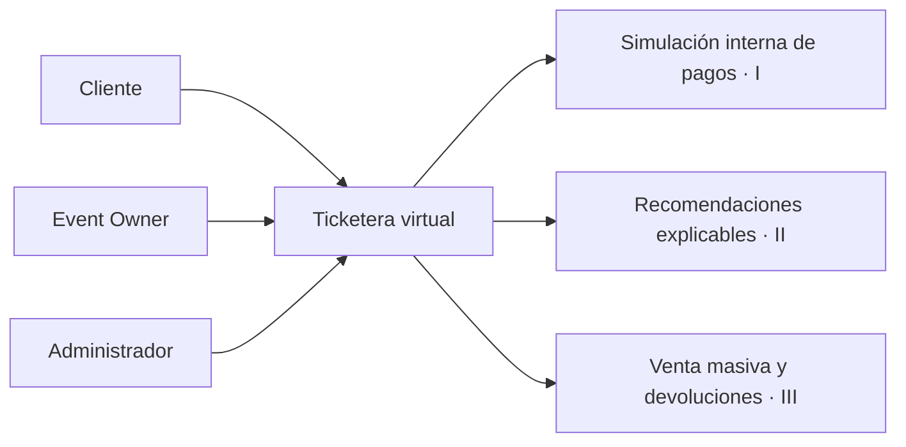

## 2. Contenedores de la Etapa I

Core propuesto. Las flechas a PostgreSQL indican acceso exclusivo a la base identificada.

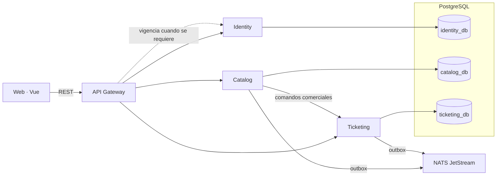

## 3. Arquitectura final prevista

I forma el Core. II incorpora Recommendations y Redis. III incorpora Waiting Room y amplía Catalog y Ticketing.

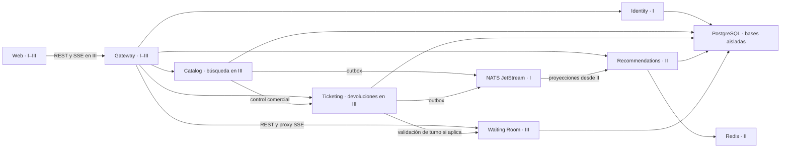

## 4. Propiedad de datos

Una instancia inicial contiene bases separadas. Las proyecciones tienen propietario local y origen remoto identificable.

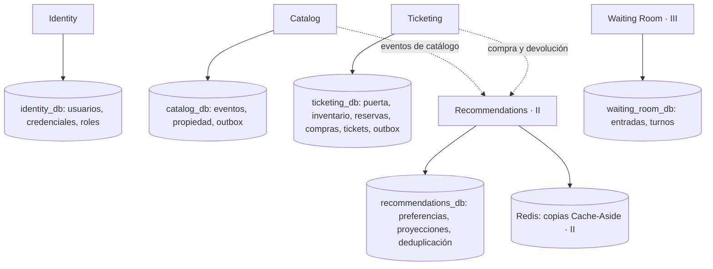

## 5. Despliegue local con Docker Compose

Topología conceptual. Bases y JetStream conservan volúmenes. Se incorporan Redis y servicios de II o III según el incremento.

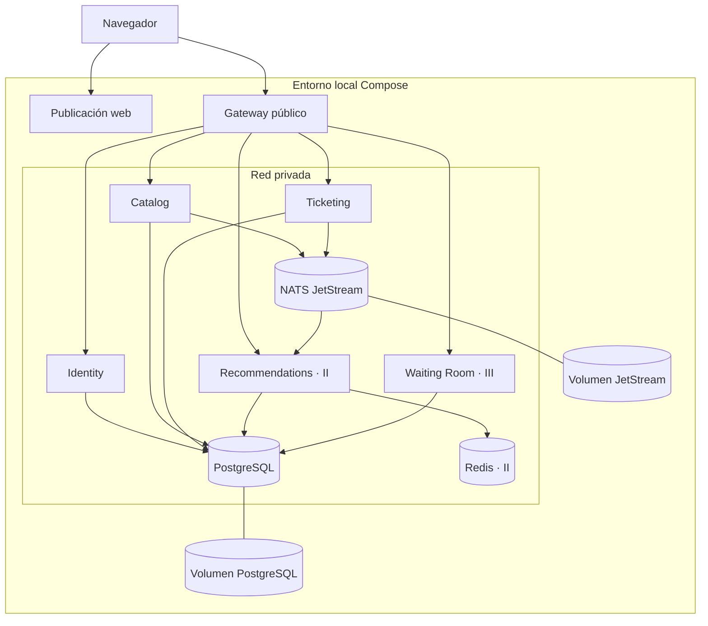

## 6. Autenticación y acceso a recurso

I. Los detalles de caducidad y comprobación de rol se concretan en ADR-006 y el design correspondiente.

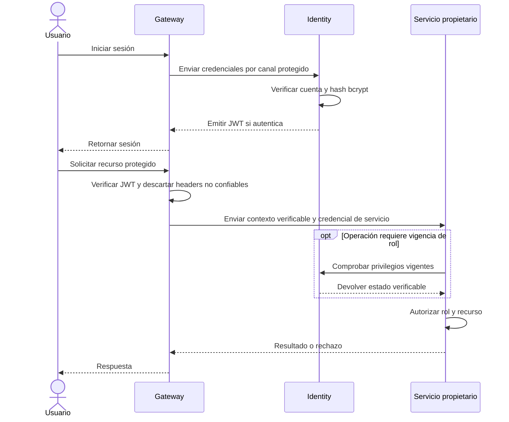

## 7. Creación, publicación y habilitación de evento

I. La preparación, publicación y apertura se coordinan por revisión. Ante incertidumbre, se consulta el estado del mismo comando.

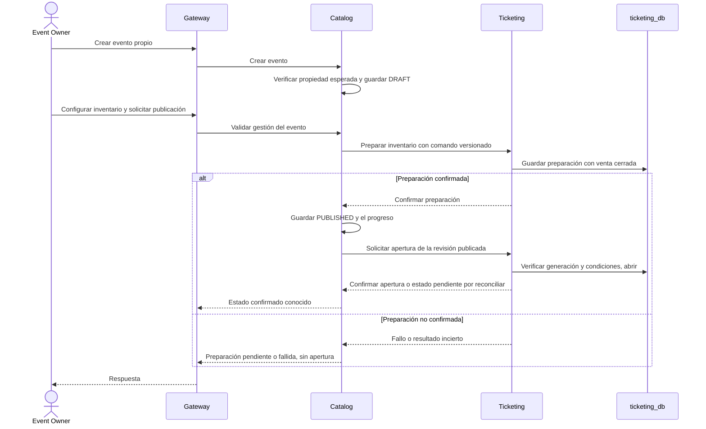

## 8. Reserva de asiento

I. Se comprueba la puerta y la exclusividad en la misma transacción de Ticketing.

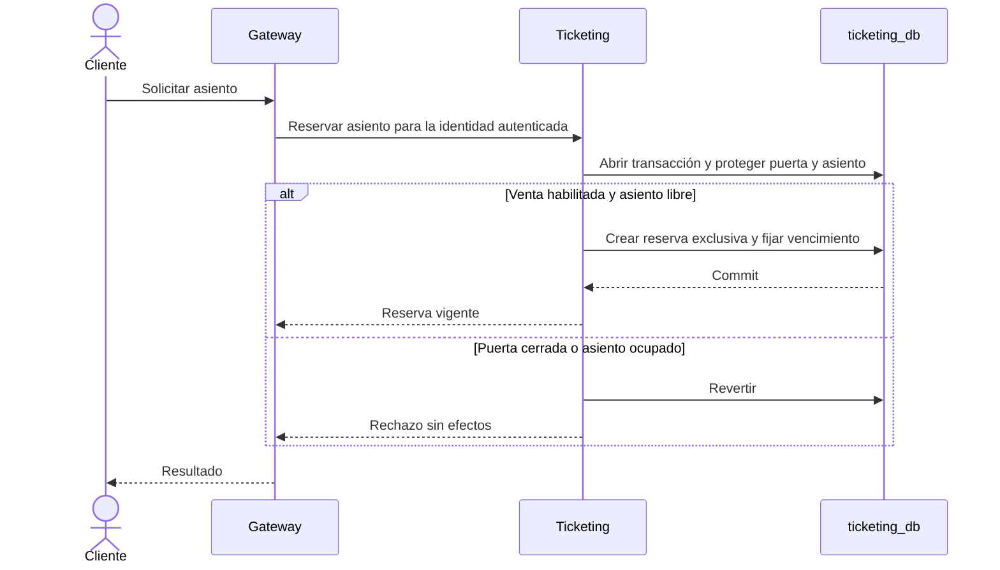

## 9. Reserva por zona

I. El compromiso se actualiza de forma condicional y se conserva como máximo la capacidad.

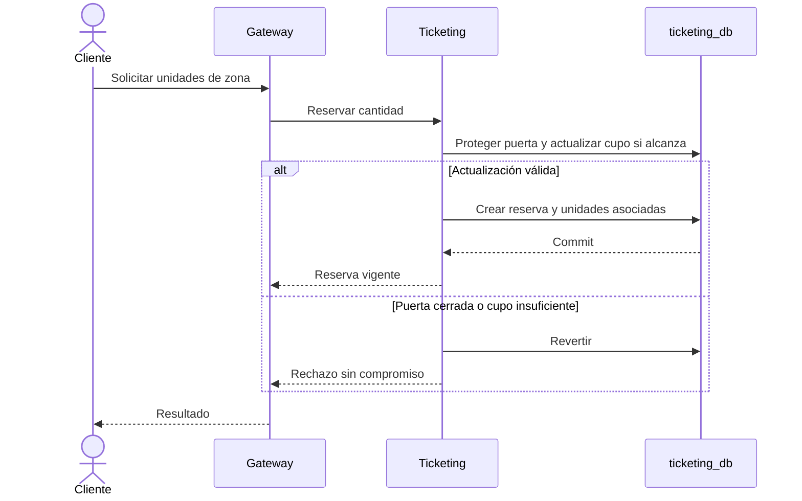

## 10. Confirmación de compra

I. El simulador permanece dentro del límite Ticketing. La prueba de turno de III se añade a la guarda local.

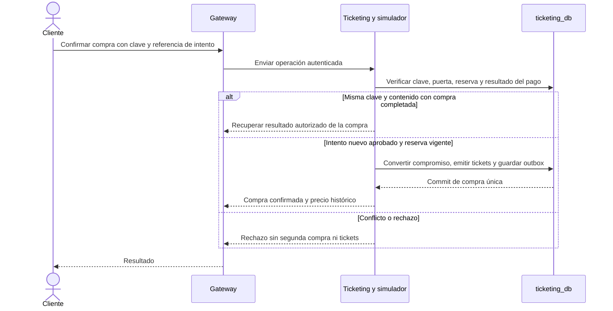

## 11. Carrera entre confirmación y vencimiento

I. El ejemplo muestra los dos órdenes válidos sobre la misma reserva.

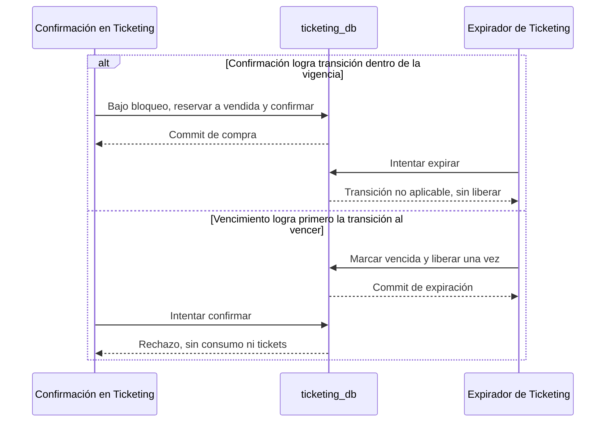

## 12. Compra confirmada con NATS no disponible

I. La respuesta de compra refleja el commit local.

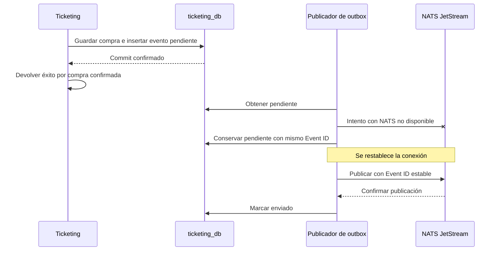

## 13. Reentrega y consumo idempotente

II y III. La reentrega puede ocurrir después del commit local y antes de que JetStream reciba el ACK.

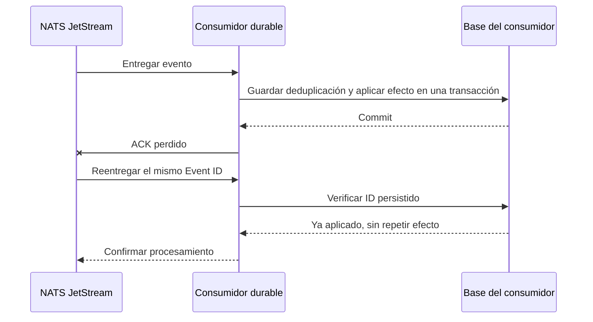

## 14. Estados del evento

I. La puerta efectiva vive en Ticketing. La cancelación con ventas confirmadas queda diferida.

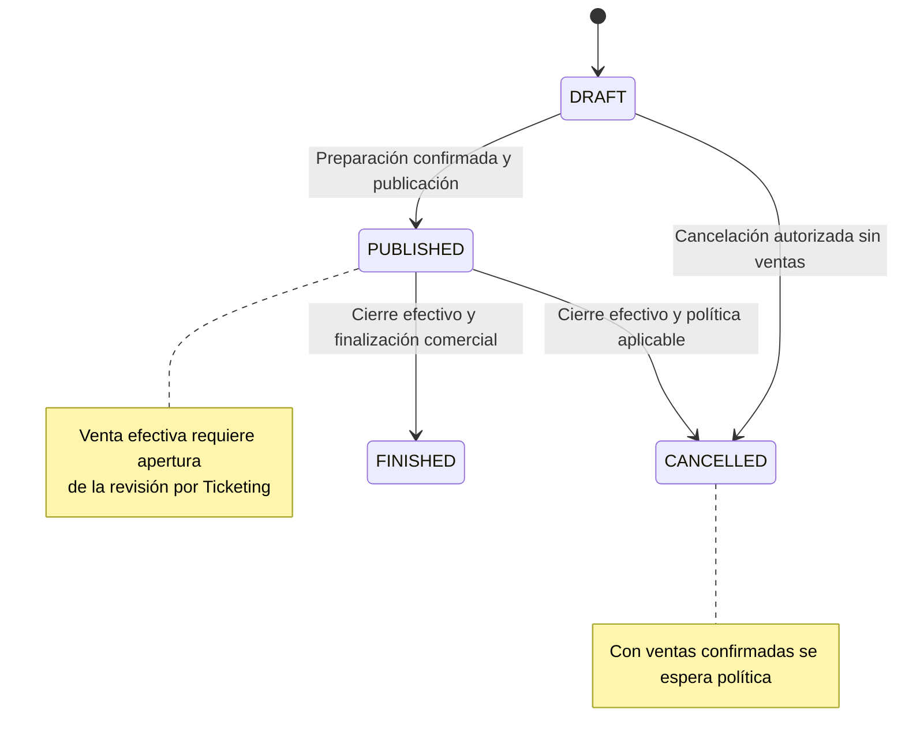

## 15. Estados de la reserva

I. Las transiciones terminales no son reversibles por expiraciones posteriores.

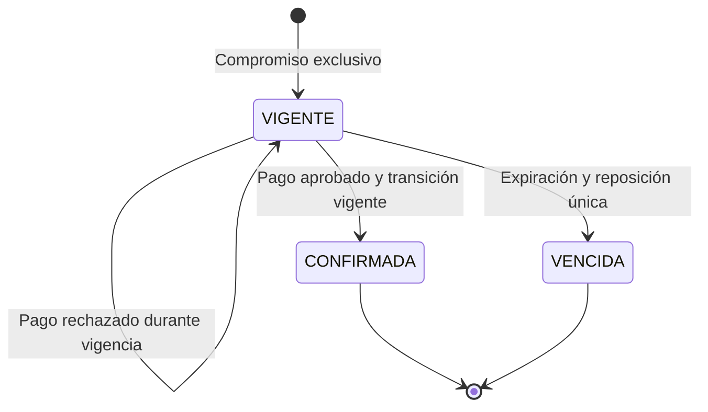

## 16. Estados de inventario numerado

I incluye reserva, venta y expiración. III incorpora reposición por devolución.

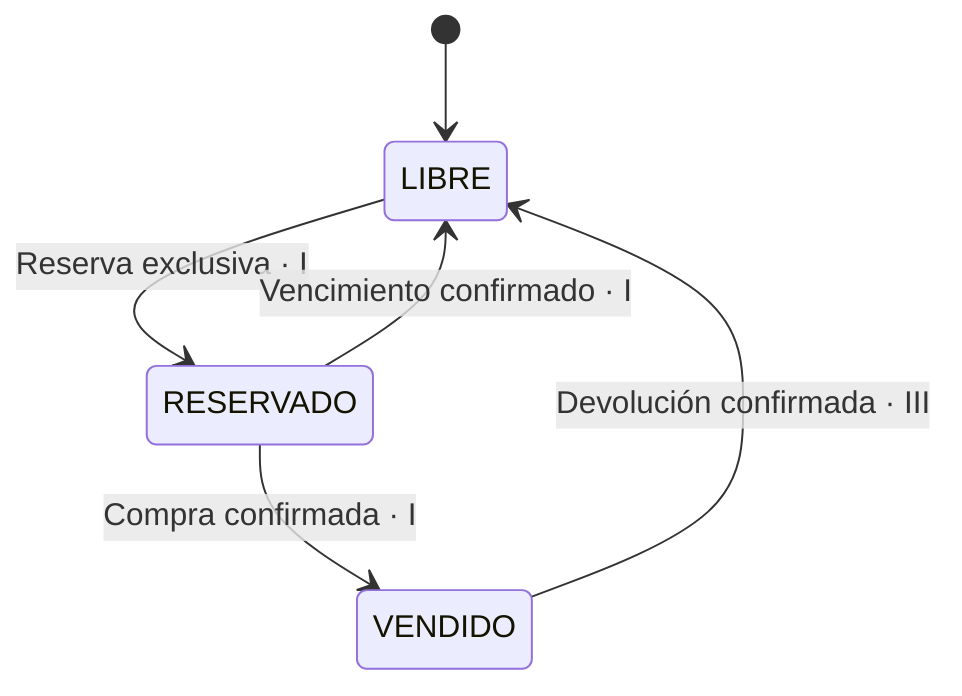

## 17. Evolución hacia recomendaciones y colas

Evolución prevista. Los componentes de cada etapa se incorporan con su change.

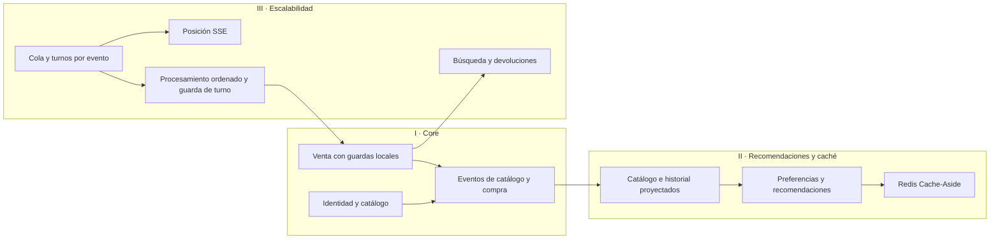
